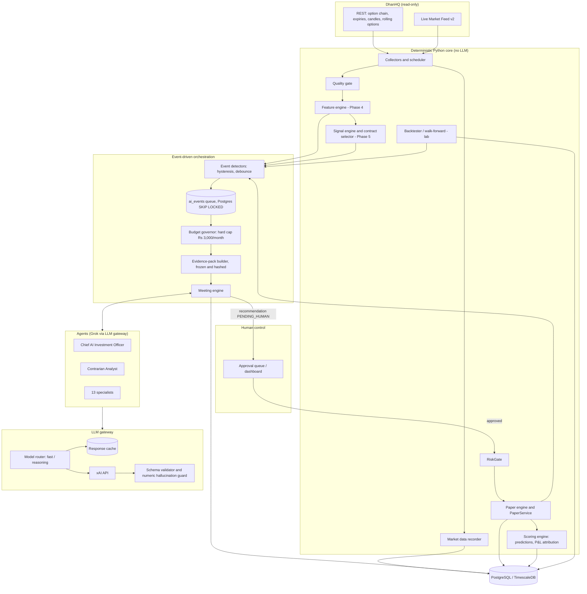

# Phase 7: Bull50 AI Financial Research Institution (architecture proposal)

Status: **proposal, awaiting approval**. No code has been written for this phase.
Baseline: commit `d1aafb5` (Phases 0–3 and 6.0–6.4 complete; Phases 4, 5 and the 7 backtester are not built).

---

## 0. Inspection summary: what exists today

| Area | Module | Relevance to Phase 7 |
|---|---|---|
| Bull50 MCP server (TS) | `server/`, `plugin/` | Separate product. The SENSEX scalping MCP has a strict "never invent a CE/PE verdict" rule (`RULES.md` §6). **Phase 7 must not feed it.** |
| Legacy engines (Py) | `engine/refresh_table.py`, `commodity_engine.py` | Pure functions (Black-76 reprice, levels). They can be reused as reference calculations; they aren't imported by `options-intelligence`. |
| Dhan data layer | `doi/data/dhan/*` | Read-only REST plus the Live Market Feed. Endpoints are allowlisted. The source of all market evidence. |
| Scheduler | `doi/data/scheduler` | Per-key Dhan rate limits. Grok traffic needs its **own** limiter and budget gate. |
| Historical | `doi/data/historical_ingestion`, `doi/data/quality` | Rolling-option planner and coverage audit. The research lab must reuse the APPROVED-only rule. |
| Config | `doi/intelligence/strategy_configs/*.yaml` | Per-index versioned config. Thresholds are uncalibrated, so they return WAIT. |
| Risk / paper | `doi/risk`, `doi/paper` | Deterministic gate plus a persisted simulator. **The only path to a paper trade.** AI recommendations must enter via `Candidate`, then `RiskGate`, then `PaperService`. |
| DB | `migrations/001`, `002` | 001 has unused placeholders: `signals`, `signal_evaluations`, `market_features`, `index_strategy_configs`, `backtest_runs`, `backtest_trades`, `market_bars`, `option_chain_*`. Nothing writes to them yet. |
| Not built | Phase 4 (feature engine), Phase 5 (deterministic signal engine and contract selector), blueprint Phase 7 (backtester), auth/roles | **Hard prerequisites** for Phase 7 (see §10, Phase 7.0). |

---

## 1. Architecture



Principles:
1. **Python decides numbers. Grok interprets them.** Every number an agent may cite comes from a frozen evidence pack. Any number in its output that isn't in the pack is rejected.
2. **Grok never runs per tick.** Only accepted events open meetings, and each event type has a debounce, a cooldown and a daily cap.
3. **The only path to a trade** is Recommendation → human approval → `Candidate` → `RiskGate` → `PaperService`. No agent holds any tool that can create an order, and there is no live-order code anywhere.
4. **Everything is recorded**: inputs (by hash), prompts (by version), outputs, cost, decisions and outcomes.

---

## 2. Agent responsibility matrix

Tiers: **F** = fast/cheap model, **R** = reasoning model (see §4). "Tools" means read-only Python functions exposed through function calling. Every tool returns data that is already in the evidence pack, or a narrower slice of it.

| # | Agent | Responsibility | Inputs (evidence pack sections) | Read-only tools | Output schema | Tier | Scored on |
|---|---|---|---|---|---|---|---|
| 1 | **Chief AI Investment Officer** | Runs the agenda, synthesises views, issues the decision, records dissent | All specialist turns, contrarian report, risk-gate dry run | `get_turns`, `risk_dry_run` | `Decision` (RECOMMEND_PAPER / WATCH / NO_ACTION / ESCALATE), rationale with evidence refs | R | Decision P&L (paper), calibration |
| 2 | **Contrarian Analyst** | Writes the strongest case **against** the proposal, plus kill criteria. Runs isolated: it sees the evidence and the proposal, but not the CIO's leaning | Evidence pack, proposal | `get_evidence(section)` | `Challenge` (thesis flaws, invalidation levels, veto Y/N) | R | Save rate (vetoed trades that would have lost), false-veto cost |
| 3 | Market Regime Analyst | Trend/volatility/time regime | Regime features, VIX, ATR, ADX | `get_features` | `Opinion` | F | Regime-call accuracy |
| 4 | Index Technical Analyst | Levels, structure, momentum | Levels, EMA/VWAP/RSI | `get_levels` | `Opinion` | F | Directional hit rate |
| 5 | Options Flow & OI Analyst | PCR changes, OI walls, wall migration | OI features | `get_oi` | `Opinion` | F | Directional hit rate |
| 6 | Volatility & Greeks Analyst | IV level and skew, theta burden, gamma proxy | Black-76 IV/Greeks (Python) | `get_vol` | `Opinion` | F | IV-direction accuracy |
| 7 | Liquidity & Execution Analyst | Whether the trade is executable at size | Spread, depth, quote age, fill-model estimate | `get_liquidity` | `Opinion` (+ executable Y/N) | F | Slippage forecast error |
| 8 | AI Risk Officer | Explains RiskGate output and portfolio exposure. **Cannot override the gate** | Gate checks, account state | `risk_dry_run` | `Opinion` | F | Drawdown avoided |
| 9 | Macro & Event Analyst | Scheduled events (RBI, budget, expiry, global cues) | Event calendar (**external source, verify**) | `get_calendar` | `Opinion` | F | Event-day accuracy |
| 10 | Sector & Breadth Analyst | Constituent breadth for BANKNIFTY/FINNIFTY/BANKEX | Constituent quotes (**source, verify**) | `get_breadth` | `Opinion` | F | Hit rate |
| 11 | Quantitative Research Lead | Writes testable hypotheses for the lab | Scorecards, regime stats, past experiments | `list_experiments` | `Hypothesis` (spec DSL, §7) | R (weekly) | Share of hypotheses that pass OOS |
| 12 | Backtest & Validation Analyst | Reviews backtest/OOS reports for overfitting and leakage | Backtest manifest and metrics | `get_backtest` | `Review` | F | Agreement with later paper results |
| 13 | Data Quality Auditor | Explains quality-gate failures and blocks meetings on bad data. **Mostly deterministic; calls Grok only to summarise anomalies** | Audit reports | `get_audit` | `QualityNote` | F | False-clear rate |
| 14 | Performance & Attribution Analyst | Post-trade and post-period reviews, agent scorecard narrative | Trades, predictions, outcomes | `get_scorecards` | `Review` | F (daily), R (monthly) | Not scored (meta) |
| 15 | Compliance & Audit Officer | Checks each decision against policy: paper-only, no guarantees, human approval, evidence cited | Decision and turns | `get_policy` | `ComplianceCheck` (pass/fail + reasons) | F | Policy violations caught |

Each agent has an immutable, versioned **instruction set** (`prompt_sha256`), a tool allowlist, a JSON output schema, a model tier and a token ceiling per turn. Changing any of these creates a new `agent_version`, and scores are tracked per version.

Quorum: a trade meeting needs at least these agents: 3, 5, 6, 7, 8, 2 and 1. The others join when their event type is relevant. Agent 13 runs before every meeting, deterministically.

---

## 3. Database schema proposal: `migrations/003_ai_research.sql`

All new tables use the `ai_` / `llm_` / `research_` prefixes. Text ids follow the engine style, and timestamps are UTC.

```text
-- agents and prompts
ai_agents(id text pk, name, role, tier, active, created_at)
ai_agent_versions(id text pk, agent_id fk, version, prompt_sha256 unique, instructions text,
                  tools jsonb, output_schema jsonb, max_output_tokens, created_at)      -- immutable

-- events and orchestration
ai_events(id, kind, underlying_key, fingerprint UNIQUE, priority, payload jsonb,
          status[QUEUED|SKIPPED|RUNNING|DONE|FAILED], skip_reason, created_at, started_at, finished_at)
ai_evidence_packs(id, event_id fk, sha256 unique, content jsonb, feature_versions jsonb,
                  data_quality_score, coverage_status, as_of_ts, created_at)            -- frozen

-- meetings
ai_meetings(id, event_id fk unique, evidence_pack_id fk, kind, status[OPEN|DECIDED|ABORTED],
            abort_reason, started_at, ended_at, tokens_in, tokens_out, cost_inr)
ai_meeting_turns(meeting_id fk, seq, round, agent_version_id fk, llm_call_id fk null,
                 stance, confidence, output jsonb, evidence_refs text[], validation jsonb,
                 PRIMARY KEY(meeting_id, seq))
ai_disagreements(id, meeting_id fk, topic, agents text[], positions jsonb, resolution, resolved_by)
ai_decisions(meeting_id pk fk, decision, rationale, dissent jsonb, compliance jsonb,
             risk_dry_run jsonb, created_at)

-- human-gated recommendations (bridge to the paper engine)
ai_recommendations(id text pk, meeting_id fk, underlying_key, direction, security_id,
                   expiry, strike, option_type, stop_loss, targets jsonb, valid_until,
                   status[PENDING_HUMAN|APPROVED|REJECTED|EXPIRED|SUBMITTED|RISK_REJECTED],
                   decided_by fk users, decided_at, decision_note,
                   paper_signal_id text unique)   -- = Candidate.signal_id, so the paper idempotency key covers it

-- predictions and performance
ai_predictions(id, agent_version_id fk, meeting_id fk, underlying_key, target[INDEX|OPTION|IV],
               direction, horizon_min, ref_value, invalidation, confidence_bucket, created_at, resolve_at)
ai_prediction_outcomes(prediction_id pk fk, resolved_at, realized_value, hit, brier, signed_return)
ai_agent_scorecards(agent_version_id, period_start, period_end, n, hit_rate, brier,
                    calibration jsonb, ic, follow_sharpe, follow_sortino, max_dd,
                    contrarian_save_rate, PRIMARY KEY(agent_version_id, period_start, period_end))

-- LLM accounting
llm_calls(id, agent_version_id, meeting_id, model, tier, request_sha256, cache_hit,
          prompt_tokens, cached_tokens, completion_tokens, reasoning_tokens,
          price_version, cost_usd numeric, fx_rate numeric, cost_inr numeric,
          latency_ms, status, error, created_at)
llm_cache(request_sha256 pk, model, response jsonb, created_at, expires_at)
llm_price_book(version pk, model, input_per_m, cached_input_per_m, output_per_m,
               effective_from, source_url, verified_at)                             -- no hard-coded prices
llm_budget_months(month pk, hard_limit_inr, soft_limit_inr, spent_inr, reserved_inr, frozen bool)
llm_budget_reservations(id, month fk, call_id, reserved_inr, settled_inr, status, created_at)

-- research laboratory
research_hypotheses(id, author_agent_version_id, statement, spec jsonb, status
                    [PROPOSED|APPROVED_FOR_TEST|TESTING|FAILED|PASSED_OOS|PAPER_VALIDATION|PROMOTED|RETIRED],
                    created_at, decided_by)
research_experiments(id, hypothesis_id fk, dataset_manifest jsonb, split jsonb,
                     code_version, config_version, status, created_at)
-- reuse 001 backtest_runs / backtest_trades (ALTER: add experiment_id, split_label, seed)
research_validations(experiment_id fk, stage[IN_SAMPLE|WALK_FORWARD|OOS|PAPER], metrics jsonb,
                     passed, started_at, ended_at)
research_promotions(hypothesis_id fk, approved_by fk users, approved_at, config_version, note)

-- historical data catalogue
historical_sources(id, name, kind[DHAN|NSE_ARCHIVE|VENDOR], licence, url, verified_at, notes)
historical_datasets(id, source_id fk, instrument_class, granularity, date_from, date_to,
                    audit_id fk data_quality_audits, status, manifest jsonb)
```

Key constraints:
- `ai_events.fingerprint` is unique, so the same event can't open two meetings.
- `ai_meetings.event_id` is unique.
- `ai_recommendations.paper_signal_id` is unique, which, together with `paper_submissions`, gives end-to-end idempotency.
- `llm_budget_months` is locked `FOR UPDATE` on every reservation, so the hard cap holds under concurrency.

---

## 4. Grok call and token-cost model

**Prices are not hard-coded.** They live in `llm_price_book`, and every call stores the `price_version` it used.

> **Requires verification on https://docs.x.ai before 7.1.** Third-party aggregators (Nov 2026) agree that the fast tier (`grok-4-fast` class) costs about **$0.20 / M input** and **$0.50 / M output**. Flagship/reasoning figures conflict between sources: $1.25–$3 input and $2.50–$15 output, depending on which model is current. Cached-input rates and whether reasoning tokens are billed as output also need confirming. So do the INR/USD rate, and whether GST applies to foreign API services.

Planning assumptions (worst case of the ranges above, for budgeting only):

| Item | Fast tier (F) | Reasoning tier (R) |
|---|---|---|
| Input $/M | 0.20 | 3.00 |
| Output $/M (incl. reasoning) | 0.50 | 15.00 |
| Typical turn | 3,000 in / 500 out | 6,000 in / 1,200 out + ~2,000 reasoning |
| Cost per turn (USD) | $0.00085 | $0.066 |
| Cost per turn (INR @ 90 + 18% GST buffer) | **₹0.09** | **₹7.0** |

Meeting cost (trade-candidate meeting):
- 6 specialists × F = ₹0.54
- Optional rebuttal round (only if disagreement): 3 × F = ₹0.27
- Contrarian × R = ₹7.0
- CIO × R = ₹7.0
- Compliance × F = ₹0.09
- **Total ≈ ₹15 per meeting, worst case.** About ₹4–5 if the cheaper flagship figures are confirmed.

Monthly budget (22 sessions), with a hard cap of **₹3,000** enforced in code and a soft alarm at ₹2,400:

| Lane | Rule | Allocation |
|---|---|---|
| Trade meetings | ≤ 3/day; ≤ 1 per index per 45 min | ₹1,200 |
| Pre-market brief (fast tier only, CIO summary on R) | 1/day | ₹220 |
| Post-market review | 1/day (fast); monthly deep review on R | ₹200 |
| Research lab (hypotheses, reviews) | weekly | ₹300 |
| Human ad-hoc questions | capped | ₹200 |
| **Reserve** (never pre-allocated; protects the hard cap) | — | ₹880 |

Cost controls:
1. **Reservation before every call.** The estimated maximum cost is `prompt_tokens × input + max_output_tokens × output` (plus a reasoning allowance). It's reserved under a row lock and refused if `spent + reserved + estimate > hard_limit`. After the call it's settled at the actual cost.
2. **Degradation ladder** when budget runs low:
   - R → F for non-decision turns;
   - then skip the rebuttal round;
   - then the CIO decides on F;
   - then **no meetings at all** (deterministic-only mode, logged and alerted).
   The month is frozen at the cap until a human raises it.
3. **Caching**: an exact-match cache keyed on (model, prompt version, evidence-pack hash, inputs). Prompts keep a stable prefix (instructions plus schema) first, so provider-side prompt caching can apply. Whether it applies, and its price, needs verifying.
4. **Token ceilings** per agent turn (`max_output_tokens`) and per meeting. Evidence packs are compact JSON (top-N strikes, summary stats), not raw chains.
5. **Model routing** is a table in config (agent × event type → tier), so it can change without code changes.
6. **Live search / web tools are off by default.** xAI bills these separately, and the pricing needs verifying.

---

## 5. Event-driven orchestration

```
features/snapshots (Python, every bar/snapshot)
   └─ detectors (pure functions, hysteresis + min dwell)
        ├─ SESSION_PRE_OPEN (09:00 IST), SESSION_POST_CLOSE (15:45 IST)
        ├─ SIGNAL_CANDIDATE (Phase 5 engine emits BUY_CE/BUY_PE candidate)
        ├─ REGIME_SHIFT (regime label changes and holds ≥ N bars)
        ├─ OI_WALL_MIGRATION (dominant wall strike moves ≥ k steps)
        ├─ IV_SHOCK (ATM IV z-score > threshold)
        ├─ PAPER_TRADE_CLOSED (paper engine)
        ├─ DATA_QUALITY_DEGRADED (quality gate) → meeting BLOCK, not a meeting
        ├─ BACKTEST_COMPLETED / OOS_COMPLETED (lab)
        └─ HUMAN_REQUEST (API)
   └─ admission control (in one transaction):
        fingerprint dedupe → cooldown per (kind, index) → daily cap → kill switch
        → market open / holiday → data quality OK → budget estimate OK
        → INSERT ai_events (QUEUED) or (SKIPPED, reason)
   └─ meeting workers: SELECT … FOR UPDATE SKIP LOCKED, one meeting per event
```

- **Tick traffic never reaches the orchestrator.** Detectors run on closed bars and snapshots (minutes), and only state *changes* emit events.
- **Queue in PostgreSQL** (`SKIP LOCKED`). Redis is already in compose but unused. There's no new dependency until load justifies one.
- **Time validity**: each event carries a `valid_until`. A meeting that starts after the market has moved past it aborts without any LLM call.
- **Separate processes**: `api`, `collector`, `ai-worker`. The AI worker never imports the paper engine's write path. It writes recommendations only.

---

## 6. AI meeting workflow

```
1  OPEN       event admitted; Data Quality Auditor (deterministic) clears or aborts
2  EVIDENCE   Python builds the evidence pack: features, levels, OI, IV, liquidity, contract chosen by the
              Phase 5 selector, RiskGate dry run, account exposure, past scorecards → frozen, SHA-256
3  ROUND 1    relevant specialists answer independently and in parallel (fast tier, they don't see each other)
              → Opinion{stance: BULL/BEAR/NEUTRAL/ABSTAIN, confidence 1-5, evidence_refs[], risks[]}
4  CONTRARIAN reads the evidence + Round 1 → Challenge{flaws[], kill_criteria[], veto: bool}
5  ROUND 2    only if disagreement index > threshold: named specialists rebut in ≤ 150 tokens
6  DECISION   CIO → Decision{action, rationale, dissent[], conditions[]}; cannot change prices/contract
              chosen by Python, only accept/reject/tighten (e.g. smaller size, earlier expiry of validity)
7  CHECKS     deterministic: schema valid · every number cited exists in the evidence pack ·
              RiskGate dry run passes · Compliance agent pass · contrarian veto handled
              (veto ⇒ CIO must give an explicit rebuttal, or the decision becomes WATCH)
8  RECORD     turns, disagreements, decision, costs → PostgreSQL (one transaction per turn)
9  HUMAN      RECOMMEND_PAPER → ai_recommendations PENDING_HUMAN (expires at valid_until)
              approve → Candidate → RiskGate (live re-check) → PaperService (signal_id = recommendation id)
10 OUTCOME    predictions resolved by Python at horizon; trade outcome attributed to agents
```

Disagreements are first-class records. Any pair of specialists with opposite stances at confidence ≥ 3 creates an `ai_disagreements` row, with each side's evidence refs and the CIO's resolution.

Crash safety: every turn is persisted before the next one starts, so a worker restart resumes from the last completed turn. Recorded turns are never re-billed, because the cache keys on the turn input hash.

---

## 7. Historical research design

### 7.1 Data tiers. Nothing is assumed: each tier must pass a coverage pilot

| Tier | Content | Candidate source | Expected span | Status |
|---|---|---|---|---|
| H1 | Index daily OHLC (NIFTY, BANKNIFTY, FINNIFTY, SENSEX, BANKEX), India VIX | Dhan `/charts/historical`; NSE/BSE index archives | 10–15 y where the index existed (FINNIFTY launched 2021 as a derivative; BANKEX F&O relaunched in 2023) | **Verify** Dhan's daily-history depth per index and the archive licence terms |
| H2 | Index intraday candles | Dhan `/charts/intraday` | **Unknown.** Dhan documents limited intraday look-back | **Verify** before relying on it |
| H3 | Expired options, ATM-relative intraday series | Dhan `/charts/rollingoption` | Dhan docs say **up to 5 years** (blueprint §6). SENSEX/BANKEX history is blocked until a pilot passes | Existing planner and audit |
| H4 | EOD option-chain snapshots (all strikes, daily) | NSE F&O bhavcopy archives; BSE equivalent | Potentially 10+ y for NSE index options | **Verify** availability, format changes over time, and licence/terms of use |
| H5 | Intraday option data beyond 5 y | Paid vendors only | — | Out of scope unless purchased and licence-reviewed |
| H6 | Macro/event calendar, FII/DII flows | NSE published reports, RBI calendar | — | **Verify** sources and licences |

**Consequence:** 10–15-year studies are possible only on **daily/EOD data** (H1, H4). Intraday option studies are limited to Dhan's documented window (H3, at most 5 y), and every dataset needs an APPROVED audit (`historical_datasets.status`).

### 7.2 Strategy research laboratory

```
Hypothesis (Quant Lead agent or human, spec DSL: universe, features, entry/exit rules, horizon)
  → human approves for testing
  → Experiment: dataset manifest (APPROVED only) + chronological split
        60% development | 20% validation | 20% untouched holdout (sealed, opened once)
  → In-sample backtest → walk-forward (rolling windows) → parameter sensitivity
  → Cost/slippage stress (×1.5, ×2) → data-loss stress → leakage tests
  → Backtest & Validation agent review (overfitting flags) + Contrarian review
  → OOS holdout opened once → pass/fail recorded (immutable)
  → Paper validation: ≥ 20 sessions / ≥ 30 trades through the existing paper engine
  → Human promotion → new versioned index config (YAML + index_strategy_configs row)
```

- Backtests reuse the **same feature, signal and risk code** as live (blueprint §14). Grok never runs inside a backtest loop. Agents review results only after a run completes.
- Hypotheses are written in a restricted spec DSL, not free code, so an agent can't inject executable logic.
- Multiple-testing control: every experiment is counted per hypothesis family, and promotion requires a deflated-Sharpe / White's reality-check style adjustment, recorded in `research_validations.metrics`.

### 7.3 Agent performance tracking

- Every opinion that states a direction becomes an `ai_prediction` with a horizon and an invalidation level. Python resolves it at the horizon from recorded market data.
- Metrics per agent version:
  - hit rate;
  - Brier score over confidence buckets (calibration curve);
  - information coefficient;
  - "follow-the-agent" paper portfolio Sharpe/Sortino/max drawdown;
  - for the Contrarian, save rate versus false-veto cost.
- Scorecards are shown with sample size, and confidence-based weighting stays disabled until n ≥ 30 per agent version.

---

## 8. Security and failure handling

| Risk | Control |
|---|---|
| API key leak | `XAI_API_KEY` held like the Dhan token: a SecretStr, redacted by the existing `RedactingFilter`, never in DB/logs/prompts |
| Autonomous trading | No order tools anywhere. Recommendations need an authenticated human approval, and approval still goes through the RiskGate live re-check. The kill switch blocks approvals |
| Prompt injection (news/text data) | External text goes into a delimited `untrusted_context` field, and agents are told it's data. Tool allowlist is read-only. Outputs are validated against JSON schema. Policy is enforced by Python, not by the model |
| Hallucinated numbers | Every numeric token in an output must match an evidence-pack value (with tolerance), or the turn is rejected and retried once, then becomes ABSTAIN |
| Malformed output | One retry with the validation error, then ABSTAIN. A meeting below quorum gives NO_ACTION |
| xAI outage / 429 / timeout | Separate rate limiter and circuit breaker, timeouts per tier. A failed meeting means no recommendation, never a default trade |
| Budget overrun | Reservation under row lock, hard cap, degradation ladder, monthly freeze |
| Stale data | Evidence pack carries `as_of_ts`. A meeting aborts if the pack is older than the event's `valid_until`. Recommendations expire |
| Model drift | Model id pinned in config, and the returned model id is recorded per call. Changing either creates a new agent version, which resets its scorecard |
| Look-ahead in research | Evidence packs are built only from data with `ts ≤ as_of_ts`. Leakage tests exist for every feature. The holdout is sealed |
| Crash mid-meeting | Turns are persisted per step and resumed. The event status machine plus the unique fingerprint prevent duplicates |
| Auditability | Prompts are stored by hash, and evidence packs, turns, costs and decisions are stored immutably. The ledger-style hash chain can be extended to `ai_decisions` if required |
| Human identity | **Auth/roles don't exist yet** (blueprint Phase 0 gap). They must be built before the approval endpoints exist |

---

## 9. Testing strategy

- **Offline by default.** A `FakeGrokClient` serves recorded or scripted responses. CI never calls xAI.
- **Contract tests**: each agent's output schema, plus golden prompts (prompt hash changes must be intentional).
- **Budget tests**:
  - concurrent reservations never exceed the cap (real Postgres);
  - the degradation ladder steps down correctly;
  - price-book versioning is applied;
  - FX/GST buffer is applied.
- **Orchestration tests**: detectors with hysteresis (no event storms on flapping features), debounce, daily caps, dedupe by fingerprint, holiday/closed-market suppression, and the kill switch.
- **Meeting tests**:
  - a full meeting replays deterministically from recorded responses (same decision row);
  - quorum failure gives NO_ACTION;
  - a contrarian veto without a CIO rebuttal gives WATCH;
  - the numeric guard rejects invented numbers;
  - crash and resume doesn't double-bill.
- **Security tests**: prompt-injection fixtures in untrusted context, no tool can mutate state, and no import path from `doi.ai` to paper write methods (an import-graph test).
- **Bridge tests**: approval → Candidate → RiskGate → PaperService, with idempotency across restart (reusing the Phase 6.1 fixtures).
- **Research tests**: split integrity (the holdout is never read before sealing is lifted), leakage, reproducibility (same manifest and seed give identical metrics), and multiple-testing accounting.
- **Scoring tests**: prediction resolution, Brier/IC maths, and attribution.
- **Manual live smoke** (flagged, capped at ₹20): one meeting against xAI to validate the pricing and usage fields.
- **The existing 144 tests stay green.** The new code lives in new packages (`doi/ai`, `doi/llm`, `doi/research`, `doi/events`).

---

## 10. Incremental implementation phases

| Phase | Scope | Grok calls | Exit criteria |
|---|---|---|---|
| **7.0 Prerequisites** | Auth and roles (API keys, `users`); persisted kill switch; market-data recorder (snapshots/bars → `option_chain_*`, `market_bars`); minimal **feature engine** (blueprint Phase 4 core: regime, OI/PCR, IV/Greeks, liquidity) with leakage tests; evidence-pack builder | none | Features reproducible from stored data; evidence packs hashed and frozen |
| **7.1 LLM gateway** | xAI client (after verifying API shape), model router, price book, budget governor with hard cap, cache, call log, `FakeGrokClient` | fake only (+1 manual smoke) | Cap holds under concurrency; costs reconcile with the provider usage fields |
| **7.2 Agent framework + core 4** | Registry, versioned prompts, schemas, numeric guard; agents CIO, Contrarian, Options Flow, Regime | fake | Deterministic replay of a full mini-meeting |
| **7.3 Events + meetings** | Detectors, admission control, Postgres queue, meeting engine, disagreement records, `ai-worker` process | fake → capped live | No event storms; resumable meetings; cost per meeting within model |
| **7.4 Human approval bridge** | Recommendation queue, approval API/UI, Candidate → RiskGate → PaperService | live (capped) | End-to-end human-approved paper trade with a full audit trail |
| **7.5 Prediction tracking** | Predictions, outcomes, scorecards, attribution | — | Scorecards reproducible from DB |
| **7.6 Remaining specialists** | Agents 4, 6–10, 12–15 | live | Quorum rules; budget lanes respected |
| **7.7 Historical + lab** | Source catalogue, verified H1/H4 ingestion, **backtester (blueprint Phase 7)**, splits, walk-forward, OOS, paper validation, promotion workflow | weekly | One hypothesis through the full pipeline with a sealed holdout |
| **7.8 Hardening** | Red-team suite, cost/agent dashboards, runbooks, backup/restore drills | — | Ops sign-off |

---

## 11. Conflicts with existing modules and proposed migrations

| # | Conflict | Proposal |
|---|---|---|
| C1 | Phases 4/5 (features, deterministic signal engine, contract selector) aren't built, but agents need Python-computed evidence and Python-chosen contracts | Build the minimal Phase 4 core in **7.0**. Until Phase 5 exists, trade meetings are triggered only by `HUMAN_REQUEST` with a human-specified contract |
| C2 | 001 `signals` (direction CHECK, bigint ids) is meant for the deterministic engine | Keep it. AI output goes to `ai_recommendations`, with an optional FK to `signals` once Phase 5 writes there. **No AI write to `signals`** |
| C3 | 001 `backtest_runs` / `backtest_trades` lack experiment linkage | Migration 003: `ALTER TABLE backtest_runs ADD experiment_id, split_label, seed`. No drop (unused today, but the blueprint names them) |
| C4 | `index_strategy_configs` (DB) vs YAML configs (current source of truth) | YAML stays authoritative. The DB row is a write-once mirror per `config_version`, written at promotion time |
| C5 | No auth: `users` table exists but no login or roles; the approval API needs identity | Build in 7.0: API-key auth with roles `viewer`, `approver`, `admin`; `decided_by` FK to `users` |
| C6 | Kill switch is in memory (`Runtime.kill_switch`) and separately inside paper state | 7.0: persist a single kill-switch row that is read by the API, the paper engine and the AI worker |
| C7 | Market data isn't stored (tables exist, no writer); Phase 7 needs stored evidence for scoring and replay | 7.0 recorder writing to `option_chain_snapshots/rows` and `market_bars`, with Timescale hypertables and retention for ticks (verify storage sizing) |
| C8 | Bull50 MCP `sensex-scalp` skill: strict "no invented verdict" and single-table output | Phase 7 outputs are **never** routed into the Bull50 MCP server or skill. `RULES.md` gets a short Phase 7 section on approval |
| C9 | `RULES.md` §7 roadmap (Dhan Sandbox, 1-lot live) | Not touched. Phase 7 remains paper/research only, and there's no live path |
| C10 | Redis is in compose but unused | Keep it unused. The queue is in Postgres, and caching starts in Postgres too |
| C11 | Paper idempotency key = `account:signal_id` | `signal_id = ai_recommendations.id`, which is unique, so a duplicate approval returns the existing order |
| C12 | Holiday calendar is partial | Orchestrator suppression depends on it. Complete it from the NSE circular before 7.3 |

Migration plan: **003_ai_research.sql** (new tables and the C3 ALTER), and **004_auth_killswitch.sql** (roles, API keys, kill-switch row). Both go through the existing checksummed runner. No existing table is dropped.

---

## 12. Items requiring external verification (blocking where marked)

1. **xAI API**: current model names, chat-completions/function-calling request shape, structured-output support, usage fields (cached and reasoning tokens), rate limits, and **prices**. These block 7.1. https://docs.x.ai
2. INR/USD conversion source and GST treatment of xAI invoices. These set the budget buffer.
3. Dhan `/charts/historical` daily depth per index and `/charts/intraday` look-back. These block H1/H2.
4. Dhan expired-options coverage for SENSEX/BANKEX (existing pilot requirement).
5. NSE/BSE archive availability, schema history and terms of use for EOD option data (H4) and index history (H1).
6. Sources and licences for the event calendar, FII/DII flows and index constituents (agents 9 and 10).
7. Whether xAI live-search tools are needed at all, and their separate pricing. Default is off.
8. Complete 2026/2027 NSE/BSE trading-holiday lists.
9. The NSE options exchange-charge rate (0.03503% vs about 0.03553%), carried over from Phase 6.

Sources for the pricing ranges above: [morphllm](https://www.morphllm.com/grok-api-pricing), [cloudzero](https://www.cloudzero.com/blog/grok-pricing/), [mem0](https://mem0.ai/blog/xai-grok-api-pricing), [pricepertoken](https://pricepertoken.com/pricing-page/model/xai-grok-4-fast), [aipricing.guru](https://www.aipricing.guru/xai-pricing/). These are third-party pages; xAI's own pricing page is authoritative.
